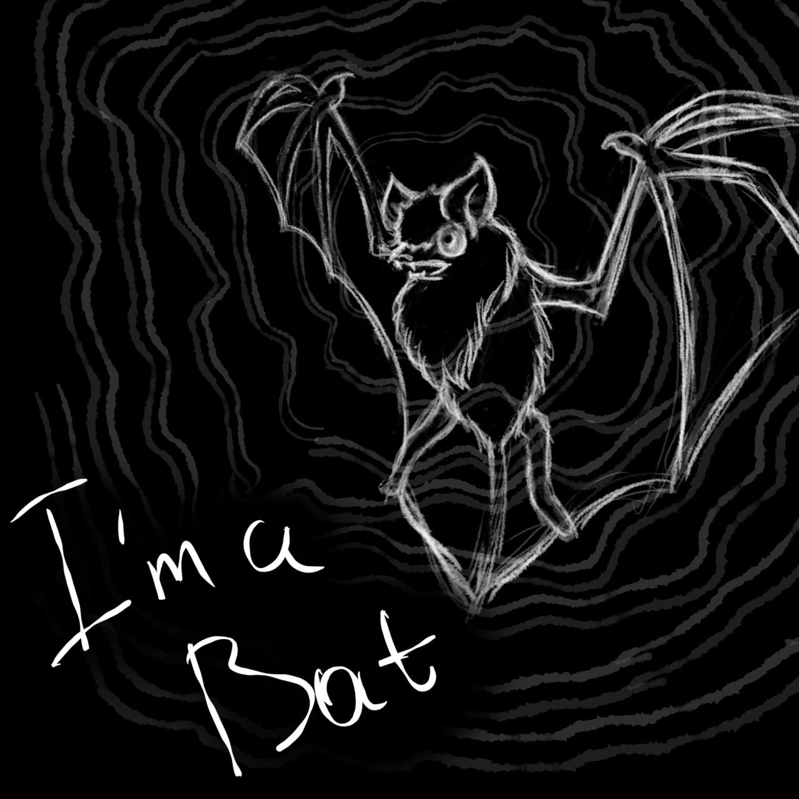

# I'm a Bat

## 1. Общая концепция

2D-головоломка-платформер с видом сбоку. Игрок — летучая мышь в тёмном мире. Постоянного «зрения» почти нет: экран тёмный, виден только малый круг вокруг мыши (радиус покоя). Чтобы увидеть мир, мышь **кричит** — звуковая волна расходится, проявляет геометрию уровня и предметы, после чего картинка плавно затухает. Вся игра строится на цикле «крик → вспышка → затухание → движение».

**Ключевой принцип:** игрок никогда не видит уровень целиком и постоянно — только фрагментами, и должен держать карту в голове.

---

## 2. Базовые механики

### 2.1. Радиус покоя (пассивное зрение)
- Вокруг мыши всегда виден маленький круг (≈2–3 корпуса мыши).
- В нём видны только **крупные** объекты: пол, стены вплотную. Мелкие предметы и скрытые элементы не видны.
- Достаточно, чтобы не упасть в пропасть под ногами, но недостаточно, чтобы планировать маршрут.

### 2.2. Крик (активное зрение)
- По нажатию мышь издаёт ультразвуковой крик.
- От мыши расходится **волна** (визуализируется кольцом). Всё, чего она касается, проявляется: контуры платформ, шипы, предметы, скрытые проходы.
- Радиус крика большой (в 4–6 раз больше радиуса покоя), но не бесконечный — дальние углы остаются тёмными.
- **Волна огибает препятствия:** за стеной предмет не проявится. Это создаёт головоломки «что за углом».
- **Кулдаун:** после крика мышь не может крикнуть снова N секунд (≈1.5–2 с). В это время доступен только радиус покоя.

### 2.3. Плавное затухание поля зрения
- Проявленные объекты не исчезают мгновенно: они плавно затухают (fade out) за 2–4 секунды.
- Игрок «видит воспоминание» о вспышке. Чем чаще кричишь (по кулдауну) — тем свежее картинка.

---

## 3. Ловушки

### 3.1. Слуховые грибы
- При крике рядом лопаются, выпуская споры: временно сужают радиус покоя до нуля (полная слепота на 3 сек).
- Не видны в радиусе покоя, проявляются только криком — игрок должен заранее замечать их в вспышке и не кричать рядом.

---

## 4. Головоломки (типы)

### 4.1. «Слепой маршрут»
Проход есть, но он **не проявляется криком** (сделан из материала, не отражающего звук — например, мягкого мха). Игрок должен пройти его по памяти после предыдущей вспышки или на слух (шорох мха). Учит доверять памяти, а не картинке.

### 4.2. «Крикни, чтобы открыть»
Механизмы (рычаги, двери) срабатывают **только от звука**. Но крик рядом активирует и ловушку. Нужно найти позицию, откуда крик достанет до механизма, но не до ловушки (геометрия + отражения).

---

## 5. Структура уровней

- **Уровень 1 — Пещера (обучение).** Радиус покоя, крик, кулдаун, затухание, шипы, одна простая дверь-механизм. Учит циклу «крик → вспышка → прыжок».
- **Уровень 2 — Чердак.** Вводятся слуховые грибы и ложное эхо. Учит «кричать осторожно»: рядом с грибами крик опасен, фальшивые платформы нужно распознавать по тембру.
- **Уровень 3 — Ночной лес.** Комбинация: слепой маршрут (мох), механизм, который надо открыть криком с безопасной дистанции, грибы у механизма и ложное эхо на пути. Финальный экзамен на все механики.

---

## 6. Визуальный и аудио-дизайн

- **Визуал:** тёмный фон, проявленные объекты — тонкие светящиеся контуры (белые/голубые). Затухание — плавное. Скрытые объекты — другой цвет (например, фиолетовый). Ложные объекты — ярче и держатся дольше.
- **Аудио:** крик мыши — короткий ультразвуковой «писк», отклики объектов — разные тембры (глухой стук = настоящее, звон = фальшивое). Грибы при активации — резкий «пшик» и шипение спор.
- **Доступность:** вся ключевая информация дублируется звуком (тембры, направление), опционально — вибрация.